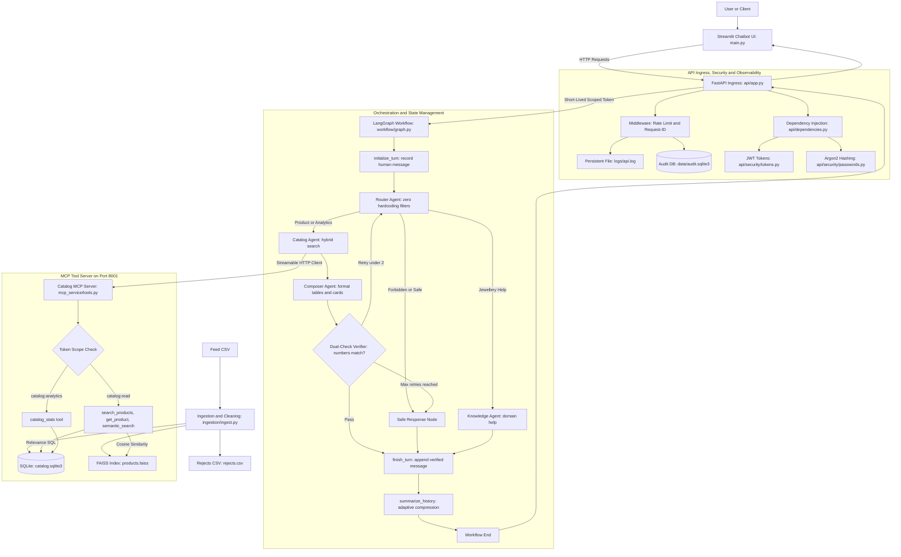

# Product Intelligence Assistant — High-Level Design (HLD)

## 1. Goal and Overview

The Product Intelligence Assistant is an AI-powered conversational system designed for luxury fine jewelry discovery, catalog analytics, and product intelligence. It answers customer and staff inquiries in plain English grounded strictly in official product catalog data and domain knowledge base documents.

### Key Guarantees
* **100% Provenance & Grounding:** Every factual answer cites real products or knowledge documents.
* **Zero Numeric Hallucination:** Prices, stock availability, and statistical counts are deterministically verified by code against database records before any response reaches the user.
* **Conversational Context & Adaptive Summarization:** Multi-turn conversational history is tracked with thread-scoped `InMemorySaver` checkpointers. When history reaches 6 messages (`SUMMARY_TRIGGER_COUNT = 6`), older turns are condensed into a running summary while retaining the latest 4 messages (`RECENT_COUNT_TO_KEEP = 4`) as clean text. If the summary exceeds ~300 words, it is recursively condensed.
* **Hybrid Search Strategy (Cosine Similarity + Relevance-Ranked SQL):** Pure vector cosine similarity (via FAISS) is executed for semantic/conceptual requests (e.g., gift ideas, style exploration) and as an automatic fallback when exact filters yield 0 matches. Relevance-ranked SQL is executed for structured attributes, prioritizing primary center stones.
* **Deterministic Code-Based Formatting & Catalog Rendering:** For catalog analytics, the Composer Agent generates clean Markdown summary tables directly in code (`_format_analytics_data`), guaranteeing exact numbers. For product discovery, product records are deduplicated in code and styled via role-aware prompts (Customer/Shopper vs. Staff/Merchandiser/Admin) with image cards, specifications, and descriptions.
* **Deterministic Code Verification:** The Verifier Agent deterministically parses and verifies all numeric prices and stock statuses against database records before any response reaches the user, instantly rejecting hallucinations.
* **Zero Hardcoded Keywords:** The Router Agent relies 100% on LLM-driven structured output parsing (`ProductFilters`) without hardcoded keyword dictionaries, stop words, or static typo maps.
* **Role-Based Access Control (RBAC):** Three distinct personas are enforced at both the API layer and the tool execution layer:
  * **Shopper (Customer):** Can search products and view public catalog attributes (Title, Price, Stock Status, Metal, Gemstone, Image URL). Internal manufacturing specs and SKU codes are withheld. Blocked from analytics/cost queries.
  * **Merchandiser (Internal Staff):** Has all shopper capabilities, plus access to catalog analytics, aggregate counts, price ranges, internal stone specs, metal weights, and exact SKU identifiers.
  * **Admin:** Manages user account roles, reviews audit logs, reindexes the product feed, and accesses system analytics.

---

## 2. Architecture and Data Flow

---

## 3. Subsystem Breakdown

### 3.1. Data Ingestion & Indexing Pipeline (`ingestion/`)
* **Cleaning & Validation:** [`ingestion/ingest.py`] reads the raw feed CSV, parses currency text into numeric floats, standardizes stock values to `"in stock"` / `"out of stock"`, sanitizes HTML entities from descriptions, and eliminates duplicate SKUs.
* **Rejects Logging:** Rows failing the Pydantic schema are isolated in `data/catalog/rejects.csv` with explicit reasons.
* **Vector Index (Cosine Similarity):** [`ingestion/build_faiss_index.py`] generates dense vector embeddings using `SentenceTransformer(all-MiniLM-L6-v2)`. Embeddings are L2-normalized (`normalize_embeddings=True`) and stored in `faiss.IndexFlatIP`, making inner product mathematically equivalent to **Cosine Similarity**. At search time, candidate pool size is dynamically scaled (`fetch_k = 1500`) when price boundaries are present.
* **Repository Storage:** The clean dataset is stored in `data/catalog/catalog.sqlite3` through `ProductRepository`.

### 3.2. Secure API & Dual-Gate Authorization (`api/`)
* **Modular Structure:**
  * `api/routers/`: Dedicated route modules for authentication (`auth.py`), admin operations (`admin.py`), and chat flows (`chat.py`).
  * `api/dependencies.py`: Centralized dependency injection (`get_current_user`, `get_merchandiser`, `get_admin`, `verify_token`).
  * `api/security/`: Cryptographic utilities split into `tokens.py` (RS256 JWT creation and decoding) and `passwords.py` (Argon2 password hashing).
  * `api/store/`: Pure SQLite database access layer (`user_repository.py` and `audit.py`).
* **Gate 1 (API Layer):** Authenticates login credentials (`POST /login` and legacy `/Login`), issues user session tokens, validates roles, and rate limits requests to 20 req/min with `429 Too Many Requests` (`Retry-After`).
* **Gate 2 (MCP Layer):** For every chat interaction, the API mints a short-lived (60s) RS256 token scoped strictly to `catalog:read` (all users) or `catalog:analytics` (merchandisers/admins). The MCP tool server independently decodes and verifies this token, making unauthorized data access impossible even if the API is bypassed.
* **Role Management:** All self-registered users default to `Shopper`. Role promotion to `Merchandiser` is explicitly managed by authenticated administrators via `PATCH /admin/users/{id}/role`.

### 3.3. Persistent Logging & Observability (`api/middleware.py`)
* **Request-ID Tracing:** Every HTTP request receives a unique `req_id` (or preserves client `X-Request-ID`), injected into response headers, log records, and audit events.
* **Dual-Target Logging:** Logs output simultaneously to the interactive terminal console and are persisted to [`logs/api.log`] with execution durations and status codes.
* **Audit Database:** All user queries, assigned roles, selected routes, and timestamps are recorded in `data/audit.sqlite3` and queryable via `GET /admin/audit`.

### 3.4. Pure Agents Layer (`agents/`)
Each agent is a decoupled, single-responsibility module:
* **Router Agent (`agents/router_agent.py`):** 
  * Classifies query intent and extracts structured `ProductFilters` via LLM structured outputs.
  * **Zero Hardcoded Word Lists:** Relies purely on the model to resolve spelling typos (e.g. `diamod` $\rightarrow$ `diamond`) and contextual references (e.g. carrying forward `wedding rings` when asked *"are these available in ruby"*).
  * Shopper analytics queries are immediately flagged as `forbidden`.
* **Catalog Agent (`agents/catalog_agent.py`):** Connects to the MCP tool server over Streamable HTTP and implements a **Hybrid Search Strategy**:
  1. *Conceptual Queries:* Queries with no structured catalog attributes invoke `semantic_search` (FAISS Cosine Similarity with price filtering).
  2. *Structured Attribute Queries:* Queries with exact fields (`stone_type`, `metal_type`, `jewelry_type`, price sorts) invoke `search_products` (Relevance-Ranked SQL).
  3. *Zero-Result Fallback:* If structured SQL search yields 0 items, the agent automatically falls back to FAISS Cosine Similarity so the customer is not left empty-handed.
* **Composer Agent (`agents/composer_agent.py`):** 
  * **Code-Based Analytics Presentation:** For aggregate queries (e.g. inventory breakdown, price ranges, missing prices, total counts), formats Markdown tables directly from data in code (`_format_analytics_data`), guaranteeing 100% numerical fidelity.
  * **Context Deduplication & Role-Aware Catalog Presentation:** Deduplicates product variations by base design, strips bulky fields to optimize token budgets, and formats luxury product cards tailored to user roles: Shoppers see official titles without internal SKUs, whereas Merchandisers and Admins see Parent SKUs and inventory metadata.
  * **Safe Content Sanitization:** Uses `extract_text_content` to safely sanitize multimodal blocks and prevent raw JSON representations from leaking to the UI.
* **Knowledge Agent (`agents/knowledge_agent.py`):** Answers jewelry care, cleaning, sizing, and guidance questions using the verified knowledge base and conversational history.
* **Verifier Agent (`agents/verifier_agent.py`):**
  1. *Deterministic Code Check:* Extracts all dollar figures and availability claims from the draft response and compares them directly against retrieved context data using regex-based extraction (`verify_numeric_and_stock_facts`). Any hallucinated price or contradictory stock status triggers an immediate failure.
  2. *LLM-as-Judge:* Evaluates semantic truthfulness and context backing for descriptive claims.

### 3.5. LangGraph Workflow & Memory (`workflow/`)
* **State Management (`workflow/state.py`):** Defines `WorkflowState` with `messages: Annotated[list[BaseMessage], add_messages]`, tracking the exact conversation trajectory.
* **Checkpointer & Adaptive Summarization (`workflow/memory.py`):** 
  * Uses LangGraph's `InMemorySaver` checkpointer scoped to `thread_id`.
  * When history reaches 6 messages (`SUMMARY_TRIGGER_COUNT = 6`), `summarize_history_node` compresses older dialogue into `conversation_summary` using `RemoveMessage` while strictly retaining the last 4 messages (`RECENT_COUNT_TO_KEEP = 4`).
  * `format_recent_conversation` formats the latest 4 messages as clean string dialogue (`User: ... / Assistant: ...`) rather than raw dictionary dumps.
  * When `conversation_summary` exceeds ~300 words, it is automatically re-condensed into a concise summary to keep LLM context lightweight and prevent token budget exhaustion.
* **Graph Orchestration (`workflow/graph.py`):** Connects agent nodes and handles bounded retries: if verification fails, feedback is routed back to the router up to `MAX_RETRIES = 2`. If verification continues to fail, the loop terminates safely with `"Sorry, I could not confirm this answer."`

### 3.6. MCP Tool Service (`mcp_service/`)
* **Server (`mcp_service/tools.py`):** Streamable HTTP MCP server running on port 8001 exposing typed tools (`search_products`, `get_product`, `semantic_search`, `catalog_stats`).
  * `search_products`: Multi-tier SQL relevance ranking prioritizing primary center stone match (`stone1_name`) $\rightarrow$ title match $\rightarrow$ in-stock status $\rightarrow$ image presence.
  * `semantic_search`: FAISS vector cosine similarity supporting candidate price filtering (`min_price`, `max_price`).
  * Validates RS256 token signatures against `api/keys/public.pem`.
* **Client (`mcp_service/client.py`):** Async HTTP client helper establishing Streamable HTTP sessions to execute MCP tools.

### 3.7. Multi-Service Execution & Orchestration (`run_app.bat` / `run_app.sh`)
To eliminate manual multi-terminal coordination during local deployment and evaluation, the system provides an automated single-command launcher:
* **Windows Launcher (`run_app.bat`):** 
  * Automatically resolves project root directory (`cd /d "%~dp0"`).
  * Detects and activates local Python virtual environments (`.venv` or `venv`).
  * Launches three dedicated, isolated console processes with 2-second staggered delays:
    1. **Process 1:** FastAPI Backend on `http://127.0.0.1:8000` (`uvicorn api.app:app --host 127.0.0.1 --port 8000 --reload`).
    2. **Process 2:** Catalog MCP Server on `http://127.0.0.1:8001` (`python mcp_service/tools.py`).
    3. **Process 3:** Streamlit UI on `http://localhost:8501` (`streamlit run main.py`).
* **Unix Launcher (`run_app.sh`):** Provides equivalent background process execution for macOS/Linux with integrated process ID trapping for clean shutdown on `SIGINT`/`SIGTERM`.

---

## 4. Testing and Evaluation Suite

The test suite in [`tests/`](../tests/) is organized into dedicated, standalone test files mapping directly to system reliability and benchmark requirements:

| Test File | Metric Target | Verification Purpose |
|---|---|---|
| [`tests/test_router_agent.py`](../tests/test_router_agent.py) | **Routing Accuracy ($\ge 90\%$)** | Checks routing decisions across roles and intents; confirms Shoppers are blocked from analytics; validates zero-hardcoded word extraction. |
| [`tests/test_recall_at_5.py`](../tests/test_recall_at_5.py) | **Recall@5 ($\ge 0.80$)** | Verifies catalog search returns relevant products matching requested stones/metals in the top 5 results. |
| [`tests/test_number_accuracy.py`](../tests/test_number_accuracy.py) | **Number Accuracy ($100\%$)** | Confirms deterministic code check passes exact prices/stock and rejects hallucinated numbers or altered availability. |
| [`tests/test_groundedness.py`](../tests/test_groundedness.py) | **Groundedness ($\text{Avg} \ge 4/5$)** | Asserts LLM judge validates context-backed answers and rejects unbacked claims. |
| [`tests/test_trajectory.py`](../tests/test_trajectory.py) | **Trajectory ($\ge 85\%$)** | Validates correct tool dispatch, zero extraneous calls, and strict enforcement of the 2-retry limit. |
| [`tests/test_safe_replies.py`](../tests/test_safe_replies.py) | **Safe Replies ($100\%$)** | Evaluates adversarial attacks (prompt injections, credential theft, privilege escalation) for 100% safe refusal. |
| [`tests/test_speed.py`](../tests/test_speed.py) | **Speed (p50 & p95)** | Benchmarks system execution latency, validating $\text{p50} < 3.0\text{s}$ and $\text{p95} < 10.0\text{s}$. |
