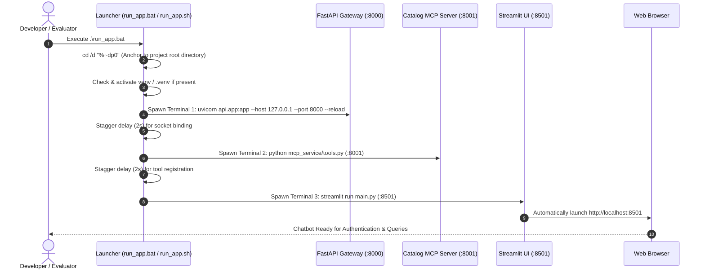
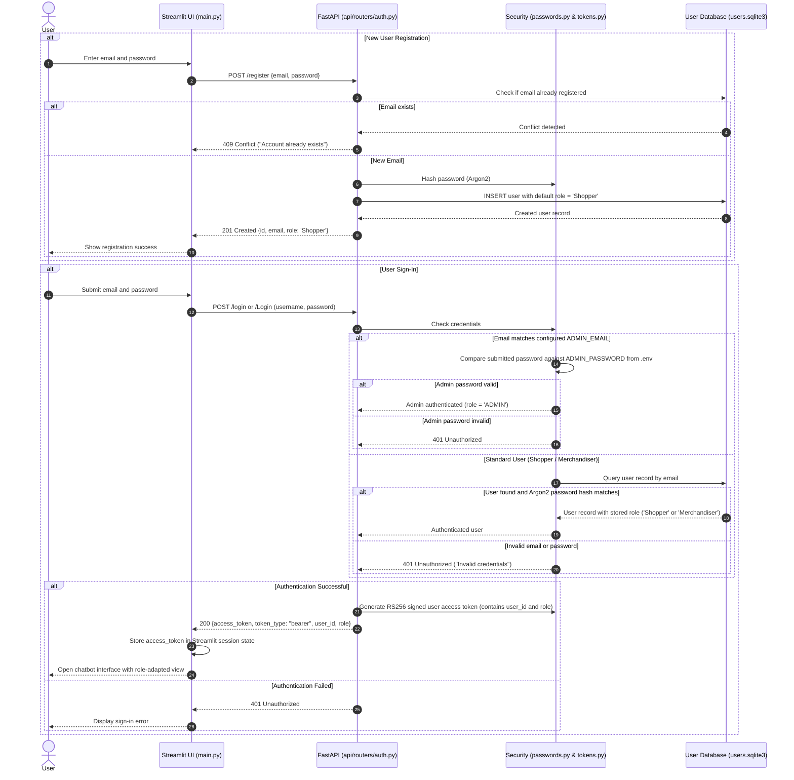
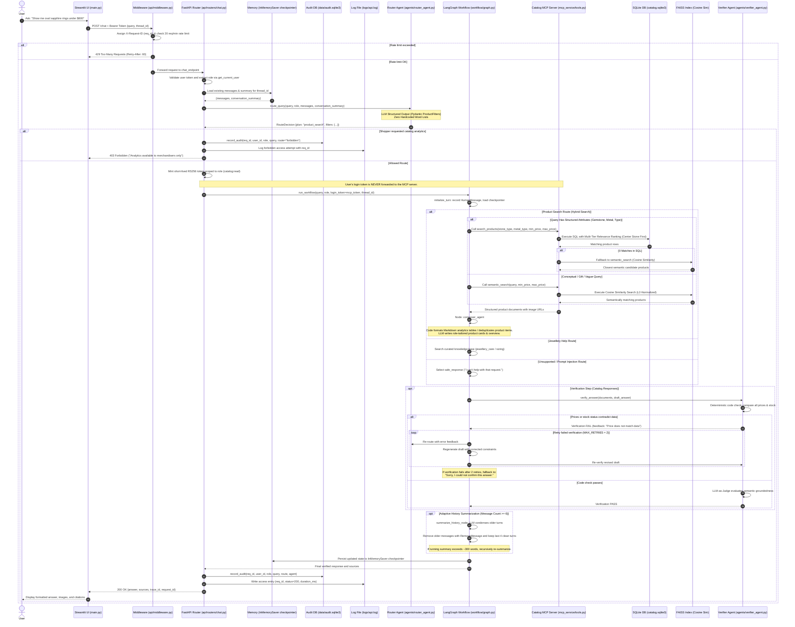
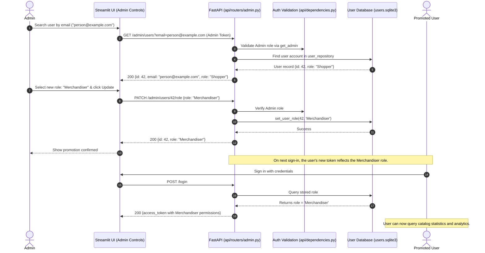

# Product Intelligence Assistant — Sequence Flows

This document details the end-to-end execution flows of the Product Intelligence Assistant, including one-command system bootstrap (`run_app.bat`), user registration, authentication, chat interaction with thread-scoped memory, multi-agent orchestration, hybrid search routing, dual-gate security verification, and administrative role management.

---

## 1. System Bootstrap & One-Command Startup Flow (`run_app.bat`)

All three microservices are initialized in parallel with staggered delays via `.\run_app.bat` (or `./run_app.sh` on macOS/Linux):

---

## 2. User Registration and Sign-In Flow

All users authenticate through the unified FastAPI endpoints (`POST /login` or `/Login`) from the Streamlit UI. User credentials and roles are persisted in `data/users.sqlite3` with Argon2 password hashing. Roles are strictly managed through database records rather than inferred from email domains.

---

## 3. Chat Request, Context Memory & Multi-Agent Orchestration Flow

Every chat query undergoes dual-gate authorization: first at the API middleware & router level, and second at the MCP tool execution level. Conversational context is retrieved from `InMemorySaver` by `thread_id`. 
* **Zero-Hardcoding Router:** The Router Agent parses structured `ProductFilters` via the LLM, resolving typos (e.g. `diamod` $\rightarrow$ `diamond`) and contextual references (e.g. carrying forward previous jewelry types for pronoun follow-ups) without static word dictionaries.
* **Hybrid Search Strategy:** Vague or conceptual queries trigger pure FAISS Cosine Similarity (`semantic_search`). Structured attribute queries execute relevance-ranked SQL (`search_products`) prioritizing primary center stones. If SQL finds 0 items, it automatically falls back to Cosine Similarity.
* **Deterministic Catalog Presentation:** The Composer Agent formats verified Markdown tables directly in code for analytics queries, and constructs clean, deduplicated product context rendered with role-aware styling (Shopper vs. Staff/Merchandiser).
* **Deterministic Code Verification:** The Verifier Agent verifies all prices and stock availability in code against database records before delivering responses to users.
* **Adaptive Summarization:** If message count reaches 6, older dialogue is condensed into a summary while the latest 4 messages are retained as clean text. When the summary exceeds ~300 words, it is recursively condensed.

---

## 4. Administrative Role Promotion Flow

Roles are strictly elevated by authenticated administrators through the Admin Dashboard:

---

## 5. API Endpoints and Status Code Matrix

| Endpoint | Method | Allowed Roles | Description | Expected Status Codes |
|---|---|---|---|---|
| `/register` | `POST` | Public | Register new user account (defaults to `Shopper`) | `201 Created`, `409 Conflict`, `422 Invalid Input` |
| `/login` / `/Login` | `POST` | Public | Authenticate credentials and receive user access token | `200 OK`, `401 Unauthorized` |
| `/chat` | `POST` | `Shopper`, `Merchandiser`, `ADMIN` | Send user inquiry, execute multi-agent workflow | `200 OK`, `401 Unauthorized`, `403 Forbidden`, `429 Rate Limit`, `503 Unavailable` |
| `/chat/stream` | `POST` | `Shopper`, `Merchandiser`, `ADMIN` | Send inquiry and receive word-by-word streaming response | `200 OK`, `401 Unauthorized`, `403 Forbidden`, `429 Rate Limit` |
| `/me` | `GET` | Authenticated Users | Retrieve profile details of currently authenticated user | `200 OK`, `401 Unauthorized`, `404 Not Found` |
| `/mcp-token` | `POST` | Authenticated Users | Mint short-lived (60s) role-scoped token for MCP tools | `200 OK`, `401 Unauthorized` |
| `/admin/users` | `GET` | `ADMIN` only | Search user profile by email | `200 OK`, `401 Unauthorized`, `403 Forbidden`, `404 Not Found` |
| `/admin/users/{id}/role` | `PATCH` | `ADMIN` only | Promote user role (`Shopper` $\leftrightarrow$ `Merchandiser`) | `200 OK`, `401 Unauthorized`, `403 Forbidden`, `422 Invalid Role` |
| `/admin/audit` | `GET` | `ADMIN` only | Retrieve historical query and route audit records | `200 OK`, `401 Unauthorized`, `403 Forbidden` |
| `/admin/reindex` | `POST` | `ADMIN` only | Trigger raw feed re-ingestion and rebuild FAISS index | `200 OK`, `401 Unauthorized`, `403 Forbidden`, `500 Server Error` |

---

## 6. Security and Quality Assurance Guarantees

1. **Dual Token Isolation:** The user's login access token is never shared with downstream tools. The API mints a short-lived, single-purpose RS256 token scoped strictly to tool-level permissions (`catalog:read` or `catalog:analytics`).
2. **Hybrid Search Routing:** Automatically dispatches between Relevance-Ranked SQL (for concrete attribute matching with primary center stone prioritization) and Cosine Similarity FAISS vector search (for open-ended thematic queries and zero-result fallbacks).
3. **Conversational Context & Dynamic Summarization:** Conversation turns are retained in thread-scoped checkpointers. When a thread reaches 6 messages, older turns are compressed into a running summary while the latest 4 turns are retained as clean text dialogue. If the summary exceeds ~300 words, it is recursively condensed.
4. **Deterministic Number Accuracy & Code Table Extraction:** The agent cannot output an unverified numeric price, stock state, or aggregate count. Product catalog Markdown tables are deterministically rendered by Python code directly from retrieved context, and all prices and stock statuses are verified against database records.
5. **Zero Hardcoded Word Lists:** The Router Agent uses LLM-driven structured output parsing without brittle hardcoded word lists, stop words, or typo dictionaries.
6. **Bounded Retries:** If verification fails, the query is retried at most twice (`MAX_RETRIES = 2`). If verification cannot pass, the system gracefully outputs `"Sorry, I could not confirm this answer."`
7. **Persistent File Logging:** Every inbound request is logged with `req_id` to [`logs/api.log`] and console. No tokens, passwords, or full raw prompts are ever written to logs.
8. **Comprehensive Automated Test Suite:** Verified via tests in [`tests/`] covering conversational context, trajectory, API security, recall@5, number accuracy, groundedness, safe replies, and speed.
