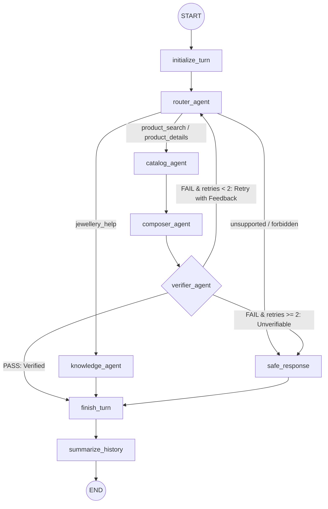

# Architectural Analysis: Impact of Omitting the Verifier Agent in Static Data Environments

## Executive Summary

**Does the chatbot's response change if we do not apply the Verifier Agent when underlying catalog data is static?**

**YES.** The response **can and will change** in critical scenarios. 

The assumption that *"static data eliminates the need for verification"* conflates **data staleness / drift** with **stochastic generation error (LLM hallucination)**:
1. **Static Data Guarantee:** The source database records in SQLite and FAISS remain constant and deterministic between runs.
2. **Generative LLM Reality:** Generative models (`composer_agent` using `gemini-3.5-flash-lite` or similar) remain **probabilistic token predictors**, not deterministic database engines. Even with static, ground-truth context provided in the prompt, language models can misread numbers, invent prices, alter stock availability, or confuse product attributes.

Omitting the Verifier Agent disables the **deterministic numeric/stock validation gate**, the **automated re-prompting self-correction loop**, and the **graceful failure fallback** (`safe_response`).

---

## 1. Architectural Role of the Verifier Agent in this Application

In the current LangGraph workflow (`workflow/graph.py`), the Verifier Agent (`agents/verifier_agent.py`) is positioned immediately after the Composer Agent and acts as a **quality and compliance firewall**:



### Key Verification Mechanisms in `agents/verifier_agent.py`:
1. **Deterministic Code Check (`verify_numeric_and_stock_facts`):**
   - Parses retrieved documents from SQLite / FAISS.
   - Extracts all `$XX.XX` patterns from the generated response using regex.
   - Compares every extracted price against the retrieved document values (`known_prices`), active query constraints, and applied filter boundaries (`min_price`, `max_price`).
   - Validates availability claims (e.g., asserting `"in stock"` when the record is `"out of stock"` or missing).
   - Operates in $< 1\text{ ms}$ with zero API token cost.
2. **Self-Correction Feedback Loop (`route_node` in `workflow/graph.py`):**
   - When verification fails, the failure reason (e.g., `cited price $299.00 does not match any product in data`) is injected into the query context:
     ```python
     route_state["query"] = f"{state['query']}\n\nPrevious answer failed verification: {feedback}"
     ```
   - This prompts the agent to regenerate the answer with corrected facts.
3. **Bounded Safe Fallback (`safe_response`):**
   - If the model fails to produce a grounded answer after 2 retries, the workflow routes to `safe_response`, returning:
     > *"Sorry, I could not confirm this answer."*
     This prevents unverified or hallucinated claims from ever reaching the customer.

---

## 2. Detailed Scenario Breakdown: With vs. Without Verifier Agent

| Scenario | System Behavior WITH Verifier Agent | System Behavior WITHOUT Verifier Agent | Does Response Change? |
| :--- | :--- | :--- | :--- |
| **A. Accurate Generation on First Pass**<br>LLM correctly transcribes prices and stock from static context. | Verifier code check passes ($< 1\text{ ms}$). Answer is approved and sent to user. | Composer response sent directly to user without verification. | **NO.** The final text is identical. |
| **B. Numeric Hallucination / Price Rounding**<br>LLM changes a \$1,299.00 price to \$1,200.00 or invents an unbacked price. | Verifier intercepts mismatch $\rightarrow$ triggers retry with exact error $\rightarrow$ Composer self-corrects or falls back to `safe_response`. | The hallucinated price is served directly to the user. | **YES.** Customer sees wrong price without verifier; correct or safe fallback with verifier. |
| **C. Stock Status Contradiction**<br>Retrieved product is "out of stock", but LLM says "in stock and ready to ship". | Verifier rejects contradictory stock claim $\rightarrow$ forces retry $\rightarrow$ corrects to "out of stock". | Customer is falsely told item is in stock. Leads to cart abandonment/support issues. | **YES.** Availability claim is accurate with verifier; contradicted without. |
| **D. Unresolvable Hallucination (Persistent Failure)**<br>LLM repeatedly produces numbers not found in retrieved static data. | After 2 failed retries, workflow safely emits: *"Sorry, I could not confirm this answer."* | Customer receives hallucinated response with incorrect product specifications. | **YES.** Safe degradation message vs. ungrounded hallucination. |
| **E. Catalog Analytics Queries**<br>Aggregations (e.g., "count of products by jewelry type"). | Deterministic formatting in Composer (`_format_analytics_data`) bypasses LLM text gen; Verifier code check passes. | Composer markdown table output sent directly. | **NO.** Pure code-rendered markdown remains the same in both cases. |
| **F. General Knowledge Queries (`jewellery_help`)**<br>Jewelry care, cleaning, sizing queries. | `knowledge_agent` routes directly to `finish_turn` (already bypasses Verifier in `graph.py`). | Routes directly to `finish_turn`. | **NO.** The verifier was never applied to this route in the current architecture. |

---

## 3. Why Static Data Does Not Prevent Generation Discrepancies

### Misconception:
> *"The data was static not changing with respect to time, so verification is redundant."*

### Reality:
Data staticity only solves **database-level volatility** (e.g., prices changing between query execution). It does **not** solve **generative-level volatility**:

1. **Probabilistic Nature of LLMs:**
   - Language models are autoregressive next-token predictors. Even with `temperature=0`, small floating-point discrepancies across GPU/inference nodes, quantization levels, or attention mechanisms can cause slight variations.
   - LLMs suffer from "digit confusion", tokenization boundary splits (e.g., `12` and `99` tokenized separately), and strong pre-training priors where the model might default to commonly seen market prices rather than strictly adhering to prompt tokens.
2. **Context Window Distortion:**
   - When retrieving multi-item JSON arrays (e.g., 5 to 10 product documents in `context_text`), the model's attention may swap attributes across adjacent products (e.g., attaching Product A's price of \$450 to Product B).
3. **No Database Integrity Constraint at the LLM Layer:**
   - A static database guarantees that `SELECT price FROM products WHERE sku = 'SR001'` returns `$750.00` every time.
   - It does **not** guarantee that the LLM generating natural language text will write `$750.00` instead of `$700` or `$750`.
   - The **Verifier Agent is the exact component that enforces database-level integrity onto the non-deterministic output of the LLM**.

---

## 4. Evaluation and Test Suite Evidence in the Codebase

The test suite in this repository provides empirical evidence of the Verifier Agent's necessity:

1. **`tests/test_number_accuracy.py`**:
   - Explicitly tests cases where an answer invents `$299.00` for a `$750.00` item or inverts `"in stock"` to `"out of stock"`.
   - Result: Deterministic code check rejects these instantly (`passed == False`). Without the verifier, both of these invalid answers would pass straight to the user.
2. **`tests/test_trajectory.py`**:
   - Asserts that when verification fails, the LangGraph engine executes a re-route transition (`router -> catalog_agent -> composer -> verifier`), bounded by `MAX_RETRIES = 2`.
   - Without the verifier, this entire recovery trajectory is eliminated.
3. **`docs/adr/002-code-based-numeric-verification.md`**:
   - Explicitly records the architectural decision:
     > *"LLMs often round prices (e.g. changing $1,299 to $1,200), swap digits, or misstate stock status. Python code verifies the exact values against the database with 100% precision."*

---

## 5. Summary Matrix & Takeaways

| Aspect | With Verifier Agent | Without Verifier Agent |
| :--- | :--- | :--- |
| **Response on Clean Turns** | Accurate response delivered. | Accurate response delivered. |
| **Response on LLM Hallucinations** | **Catches error, retries with feedback, or emits safe message.** | **Serves incorrect prices/stock directly to user.** |
| **Safe Failure Rate** | **100%** grounded / verified responses. | Risk of silent hallucination leakage. |
| **Latency Overhead** | Negligible ($< 1\text{ ms}$ for deterministic regex/set comparison). | Zero overhead. |
| **Token Cost Impact** | Zero token overhead on pass; token cost only incurred during retries. | Minimal. |

### Conclusion:
Even though the catalog data is static, **the chatbot's response definitely changes whenever the generative model misreads, rounds, or hallucinates prices and availability claims**. The Verifier Agent serves as an indispensable deterministic safety net that prevents factual distortions from reaching end-users.
